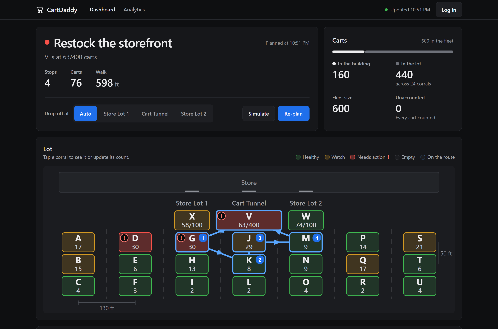
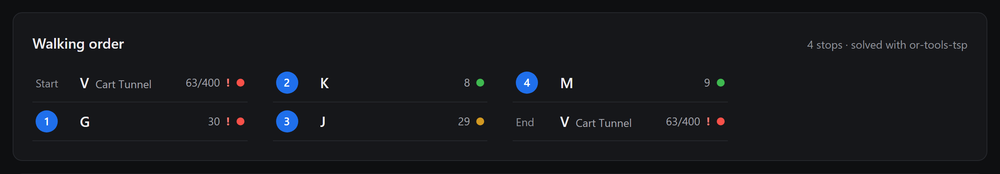
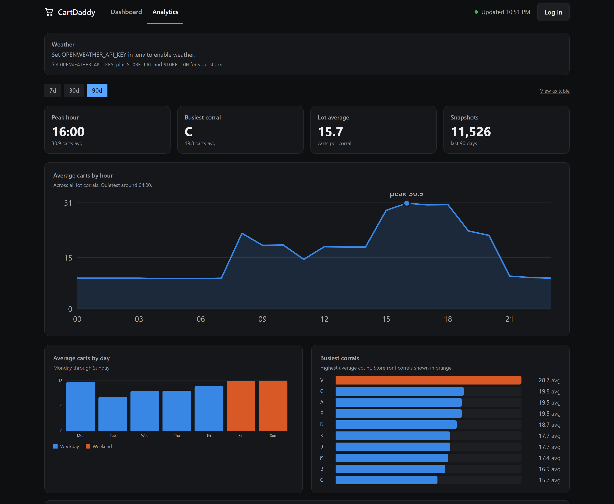

<h1 align="center">CartDaddy</h1>

<p align="center"><b>Tells a cart pusher which corral to walk to next, and the shortest way to get there.</b><br>
CartDaddy tracks cart counts across a real grocery store parking lot, decides whether the urgent job right now is clearing the lot or restocking the entrance, and solves the walking route for that job with OR-Tools. The lot was measured on site, so the route comes back in feet.</p>

<p align="center">
  
  
  
  
  
  
</p>

<p align="center"></p>

<p align="center">Built by <a href="https://github.com/StevenGantumur">Steven Gantumur</a>, who used to push the carts.</p>

## Why this exists

I worked as a cart pusher at Woodman's (a Midwest grocery chain), and the job came down to one question you answer badly all day: which corral do I walk to next? You guess, you walk, and half the time somebody else already cleared it or a closer one filled up behind you. This is the app I wanted.

## How it works

1. **Count.** Every corral on the lot has a live count. Each update also writes a snapshot, so the history the model trains on keeps growing.
2. **Decide.** The API picks the job. If a storefront corral is running low, it's a restock. Otherwise it's a collection sweep of every lot corral worth the walk.
3. **Route.** The chosen stops go to a TSP solver (Google OR-Tools) over measured distances, and the route comes back in feet.
4. **Predict.** A LightGBM model learns cart counts by corral, hour and day of week from the snapshot history.

The screenshot at the top is a restock. The Cart Tunnel (V) is down to 63 of its 400 carts, so CartDaddy sends the worker to the nearest corrals that have carts until they have a full load, then back to the entrance:

<p align="center"></p>

Four stops, 76 carts, 598 ft. The label in the corner says which algorithm produced the route, which matters more than it sounds ([see below](#when-the-solver-fails-it-says-so)).

## What's in it

- **Live lot map** drawn to measured dimensions (based on google maps), with the route drawn over it and each stop numbered
- **Job picker** that decides between restocking the storefront and sweeping the lot
- **Drop-off override**: Auto, Store Lot 1, Cart Tunnel or Store Lot 2
- **Shortest route** from OR-Tools, in feet, with a clearly labeled fallback if the solver is unavailable
- **Fleet card** that tracks all 600 carts between the building and the lot, with an unaccounted count that should read zero
- **Corral sheet**: tap any corral to see its recent history or update its count
- **Auto refresh** every 30 seconds, since the screen is meant to sit on an iPad at the cart base all shift. A route is flagged out of date when counts move after it was planned
- **Analytics**: peak hours, day-of-week pattern and busiest corrals over 7, 30 or 90 days
- **Weather**, translated into its expected effect on cart flow
- **Simulate** button that randomizes the lot to a plausible state and re-plans
- **JWT auth** on writes. Reads stay open so the app demos without an account

## The lot

The layout is sort of the real one, because I measured on google maps.

| Kind | Corrals | Where | Urgent when |
|---|---|---|---|
| **Return** | 21, A to U | Out in the lot. 7 columns ~130 ft apart, 3 rows ~50 ft apart | Full |
| **Supply** | 3: Store Lot 1 (X), Cart Tunnel (V), Store Lot 2 (W) | At the storefront, 50 ft in front of the nearest lot corral | Empty |

That last column is the important part. Urgency runs opposite between the two types: a return corral is a problem when shoppers have filled it, a supply corral when they have emptied it. One shared threshold would mark a well-stocked entrance as an emergency, so the two are scored separately everywhere: in the API, in the map colors, and in the routing.

All of it lives in [`shared/layout.json`](shared/layout.json), which both the map and the optimizer read. Moving a corral is a one-line edit, and the picture and the math stay in agreement. They used to disagree, because the coordinates were duplicated in the route file.

## Picking the job

Rather than always sweeping the lot, the API decides what is actually urgent so cart runners aren't always running.

- **Restock** wins whenever a storefront corral drops below its low-water mark. A shopper who can't find a cart is a problem right now, while a full lot corral only costs a longer trip later. A restock takes the **nearest** corrals with carts until the worker is loaded, because the point is refilling the entrance fast, not being thorough.
- **Collection** is the default: a sweep of every lot corral above the threshold, ending at whichever storefront corral is closest to the work.
- **Delivery** is the override. A worker who already knows where they want to drop off picks a bay (`?depot=X`, `V` or `W`), and the API plans a run to it from the nearest stocked corrals, whatever the automatic rule would have picked.

Low-water marks are set per corral (`lowWater` in the layout file) rather than as one global fraction, because a 400-cart reservoir and a 100-cart bay at the door don't become urgent at the same percentage.

The chosen stops go to [`optimizer/optimizer.py`](optimizer/optimizer.py), which builds a Euclidean distance matrix and hands it to OR-Tools: `PATH_CHEAPEST_ARC` for a first solution, then guided local search to improve it, capped at 5 seconds.

## When the solver fails, it says so

If Python is missing or the solve fails, the API falls back to ordering stops by cart count. That fallback ignores distance entirely, so the response is marked `degraded: true` and the UI shows a warning.

An earlier version fell back silently, which meant the optimizer could be broken indefinitely without anyone noticing. It was, in fact, broken the whole time: the code spawned `python3`, which doesn't exist on Windows, so every request quietly used the worse algorithm and still reported success. Now the interpreter is configurable (`PYTHON_BIN`), and every route reports the method that produced it.

## The prediction model

LightGBM regression on `corral_snapshots`, aggregated into hourly averages per corral, day and hour. Hour and day of week are encoded as sin/cos pairs, so the model knows hour 23 sits next to hour 0 rather than 23 units away from it.

Last training run, on 51,313 snapshots (4,032 aggregated examples):

| Metric | Value |
|---|---|
| Mean absolute error | 0.68 carts |
| Root mean squared error | 1.18 carts |
| R² | 0.983 |

**That R² is not as good as it looks.** The training data is synthetic, generated by [`scripts/generateData.js`](scripts/generateData.js) from a known pattern plus noise, and averaging to hourly means removes most of that noise. The model is largely recovering a function I wrote. It is a working end-to-end pipeline, not evidence that cart counts are 98% predictable. We would need some real data here.

Top features by importance were corral identity, then day of week, then hour, which at least matches intuition: which corral you are looking at matters more than when.

## Analytics

<p align="center"></p>

A second view charts the snapshot history: average carts by hour, by day of week, and the busiest corrals, over 7, 30 or 90 days. One endpoint returns all of it, since the aggregates are always drawn together.

The charts are hand-drawn SVG rather than a charting dependency. Series colors were checked with a palette validator against the dark surface instead of picked by eye, single-series charts carry no legend, only the peak is labeled directly, and a table view exposes the exact numbers.

Weather is proxied through the API, so the OpenWeather key stays server-side and one cached call serves every client. Without a key the panel shows a setup hint (as above) rather than breaking. If the service is unreachable it serves the last good reading, marked stale. Conditions are translated into an expected effect on cart flow, since rain and cold are what actually change how fast corrals fill.

## System design

```
┌──────────────────┐   HTTP    ┌──────────────────┐    SQL    ┌──────────────────┐
│  React + Vite    │ ────────> │  Express API     │ ────────> │  PostgreSQL      │
│  lot map, job,   │ <──────── │  job picker,     │ <──────── │  corrals,        │
│  analytics       │   JSON    │  auth, weather   │           │  snapshots, users│
└──────────────────┘           └────────┬─────────┘           └────────┬─────────┘
                                        │ spawn, JSON over             │ reads history
                                        │ stdin/stdout                 │
                                        v                              v
                               ┌──────────────────┐           ┌──────────────────┐
                               │  optimizer.py    │           │  ml/trainModel.py│
                               │  OR-Tools TSP    │           │  LightGBM        │
                               └──────────────────┘           └──────────────────┘
```

The Express API owns the database. Python does the two things Python is better at, route solving and model training. The solver is called per request as a subprocess, with JSON over stdin/stdout. Not the fastest possible design, but it keeps each language doing what it is good at without standing up a second service.

| Table | What's in it |
|---|---|
| `corrals` | Current state, one row per corral, with coordinates and type |
| `corral_snapshots` | Append-only history, one row per update. What the model trains on |
| `store_state` | A single row: carts inside the building and the fleet size |
| `users` | Worker accounts, bcrypt hashes only |
| `corral_predictions` | Reserved for cached predictions, not used yet |

## Stack

| What | How |
|---|---|
| Frontend | React 19, Vite 7, Tailwind CSS, hand-drawn SVG for the map and charts |
| API | Node.js, Express 5 |
| Database | PostgreSQL |
| Routing | Python, Google OR-Tools |
| Prediction | Python, LightGBM, scikit-learn, pandas |
| Auth | JWT, bcrypt |
| Weather | OpenWeather, proxied and cached by the API |

## Run it

Needs Node 18+, Python 3.10+ and PostgreSQL 14+.

```bash
npm install
pip install -r ml/requirements.txt
```

Create the database and run the migrations:

```bash
createdb cartdaddy
psql cartdaddy -f database/migrations/001_create_corrals.sql
psql cartdaddy -f database/migrations/002_create_snapshots.sql
psql cartdaddy -f database/migrations/003_create_predictions.sql
psql cartdaddy -f database/migrations/004_create_users.sql
psql cartdaddy -f database/migrations/005_layout_and_store_state.sql
```

Copy `.env.example` to `.env` and fill it in. The Node API and the Python scripts both read this one file.

```bash
cp .env.example .env
node -e "console.log(require('crypto').randomBytes(48).toString('hex'))"   # paste as JWT_SECRET
```

Load the layout, seed history, train the model and make an account:

```bash
node scripts/syncLayout.js                            # push shared/layout.json into the database
node scripts/generateData.js                          # 90 days of synthetic snapshots, ending today
cd ml && python trainModel.py && cd ..
node scripts/createUser.js <username> <password> manager
```

Then start both halves:

```bash
# terminal 1, API on http://localhost:3001
npm run dev:backend

# terminal 2, app on http://localhost:5173
npm run dev:frontend
```

The seeded history ends on the day you run the seeder, so over time it ages out of the analytics windows and the model's 90-day training window. Re-run `generateData.js` to top it up. It appends, so clear `corral_snapshots` first if you want a clean slate.

| Variable | Default | What it does |
|---|---|---|
| `DB_HOST`, `DB_PORT`, `DB_NAME`, `DB_USER`, `DB_PASSWORD` | | Postgres connection |
| `JWT_SECRET` | required | Signs login tokens |
| `JWT_EXPIRES_IN` | `8h` | Token lifetime |
| `WORKER_CAPACITY` | `60` | Carts one worker moves per run |
| `MIN_CART_THRESHOLD` | `5` | Lot corrals below this aren't worth the walk |
| `SUPPLY_LOW_WATER` | `0.4` | Restock threshold for a supply corral with no `lowWater` of its own |
| `PYTHON_BIN` | `python` on Windows, `python3` elsewhere | Interpreter for the solver |
| `OPENWEATHER_API_KEY`, `STORE_LAT`, `STORE_LON` | | Weather panel, optional |
| `ALLOW_SIMULATE` | `true` | Set to `false` to turn off the Simulate button on a real deployment |
| `PORT` | `3001` | API port |
| `VITE_API_BASE` | `http://localhost:3001` | Where the frontend finds the API |

## Trying it out

The **Simulate** button randomizes all 24 corrals to a plausible state and re-plans against it, so the map, the counts and the job all move in one click. Run it a few times and it swings between a collection sweep and a restock, depending on where the carts land.

Carts are weighted toward the rows nearest the doors, with an occasional spike on one corral, so a simulated lot has a handful of corrals clearly worth walking to rather than 21 sitting at the same average. A typical sweep comes out around 200 to 240 carts across 14 to 18 corrals.

Every count stays consistent with a fixed fleet of 600 carts. The Cart Tunnel is treated as the reservoir and takes whatever the rest of the store isn't holding, so the books always balance and the unaccounted tile stays at zero.

## API

| Method | Endpoint | Auth | Description |
|---|---|---|---|
| GET | `/health` | | Liveness, plus a real database check |
| POST | `/api/auth/login` | | Exchange credentials for a token |
| GET | `/api/auth/me` | token | Confirm a token is still valid |
| GET | `/api/corrals` | | Lot state, counts and building totals |
| POST | `/api/corrals` | token | Update one corral. Writes a snapshot |
| GET | `/api/corrals/:id/history` | | Recent snapshots for one corral |
| GET | `/api/building` | | Carts inside the store |
| POST | `/api/building` | token | Update the building count |
| GET | `/api/optimize-route` | | The next job and its route (`?depot=` to pick a bay) |
| GET | `/api/optimize-route/preview` | | Current optimizer configuration |
| GET | `/api/analytics` | | Aggregated history over `?days=` |
| GET | `/api/weather` | | Current conditions and cart impact |
| POST | `/api/simulate` | | Randomize the lot (demo, behind `ALLOW_SIMULATE`) |
| GET | `/api/shifts` | | Worker shifts (stub) |

Asking what to do next:

```bash
curl http://localhost:3001/api/optimize-route
```

```json
{"success":true,"job":"restock","reason":"V is at 63/400 carts","depot":"V",
 "optimizedRoute":["V","G","K","J","M","V"],"totalDistance":597.84,
 "corralsCovered":4,"cartsMoved":76,"method":"or-tools-tsp","units":"feet"}
```

Updating a corral:

```bash
curl -X POST http://localhost:3001/api/corrals \
  -H "Content-Type: application/json" \
  -H "Authorization: Bearer $TOKEN" \
  -d '{"corral_id": "C", "count": 30}'
```

## Project structure

| Folder | What's in it |
|---|---|
| [`frontend/`](frontend/) | React app: lot map, job panel, fleet card, corral sheet, analytics |
| [`backend/`](backend/) | Express API: routes, JWT middleware, shared Postgres pool |
| [`optimizer/`](optimizer/) | OR-Tools TSP solver, called by the API as a subprocess |
| [`ml/`](ml/) | LightGBM training and prediction |
| [`database/`](database/) | SQL migrations |
| [`scripts/`](scripts/) | Data seeder, layout sync, user creation |
| [`shared/`](shared/) | The lot layout and corral whitelist, read by every layer |
| [`docs/`](docs/) | The [original design notes](docs/original-design-notes.md) |
| [`assets/media/`](assets/media/) | README screenshots |

## What's real and what isn't

**Real**
- The route is solved by OR-Tools over the measured lot, and every response says which method produced it
- Counts, snapshots, the building total and accounts are stored in PostgreSQL
- The model trains end to end on the snapshot history
- Auth, analytics and the weather proxy all work against real services

**Not yet**
- Cart counts are entered by hand or simulated. The plan was RFID sensors in each corral, which I don't have. `POST /api/corrals` is the seam a sensor would use.
- The model is trained but not wired to the UI. [`ml/predictCorral.py`](ml/predictCorral.py) works from the command line, but no endpoint calls it.
- `/api/shifts` returns fixed sample data.
- The training data is synthetic. See the note on the R² above.
- One worker at a time. Splitting corrals between people on a shift isn't modeled.

## Where this is going

This is a prototype, and it leans towards more visual examples than real production. The lot state is simulated rather than sensed. What runs underneath it is real: the route is solved with OR-Tools over measured distances, the counts are stored in PostgreSQL, and the model is trained on the snapshot history. It is proof the idea works, not a finished product.

The next thing I want to build is a simulation page that proves the point directly: that a worker who can see the best route on a device beats a worker walking the lot looking for full corrals. Right now that time goes into guessing, doubling back, and clearing a corral somebody already got. I think the difference is real, and I would rather measure it than claim it.

I worked carts. It is a lot of walking and a lot of guessing, and most of that is avoidable. Done right, this cuts the physical strain of the job and gives cart workers back time and better tools to succeed at it. I would like to see it running at a real store at scale someday. Getting there takes a lot of RFID sensors and production-level design work, which is not a small lift, but none of it is out of reach.

**Road map**

1. A simulation page that measures a routed worker against one walking the lot by eye
2. Expose predictions through the API and show them on the map
3. Predicted vs actual on the analytics view
4. Real shift scheduling instead of the stub
5. Sensor ingestion, with per-device keys and smoothing over a rolling window
6. Feed weather into the model, since rain visibly changes how fast corrals fill
7. Multi-worker routing

## Credits

Routing by [Google OR-Tools](https://developers.google.com/optimization). Prediction with [LightGBM](https://lightgbm.readthedocs.io). Weather from [OpenWeather](https://openweathermap.org/api). Built with [React](https://react.dev), [Vite](https://vite.dev), [Tailwind CSS](https://tailwindcss.com), [Express](https://expressjs.com) and [PostgreSQL](https://www.postgresql.org).
